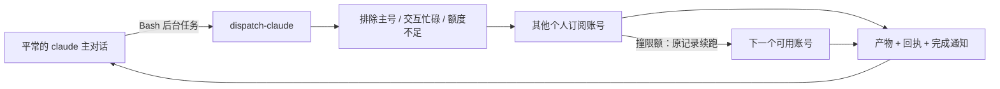

# claude-pro-pool

**主对话负责统筹，把耗时的 Claude Code 任务派给你自己的其他 Pro/Max 账号，在后台完成。**

[English](README.en.md) · [命令与配置](docs/commands.md) · [测试记录](docs/testing.md)

有两个或更多订阅，却总是把当前主号的额度用完？本工具会挑选其他有余量的账号运行无界面的 Claude Code，结果落盘；撞限额时把原对话记录搬到另一个账号，继续同一个任务。安装后，新的 `claude` 主对话会加载派单规则，默认把重活派出去。



## 30 秒快速开始

需要 **macOS、已安装的 [Claude Code CLI](https://code.claude.com/docs/en/setup)、至少两个本人的 Pro/Max 订阅**。首次下载 uv、Python 和依赖通常超过 30 秒，取决于网络。不需要预装 claude-swap、Python 或本项目的任何脚本。

```bash
git clone https://github.com/aaronyi97/claude-pro-pool.git
cd claude-pro-pool
bash ./install.sh
export PATH="$HOME/.local/bin:$PATH"
```

或者直接安装（仓库发布后可用）：

```bash
curl -fsSL https://raw.githubusercontent.com/aaronyi97/claude-pro-pool/main/install.sh | bash
export PATH="$HOME/.local/bin:$PATH"
```

安装器通过 [uv 官方安装脚本](https://docs.astral.sh/uv/getting-started/installation/) 补齐 uv，用 `uv tool install --python 3.12 claude-swap==0.26.0` 安装固定版依赖。依赖位于工具自己的目录，不替换全局 claude-swap。规则块和 PATH 块可重复安装；已有文件先备份。**默认子任务使用 `bypassPermissions`，能在当前用户权限下执行命令与改文件。请先阅读下方权限说明。**

## 逐个加号

先登记平常使用的主号。如果还没有登录，先手动执行 `claude auth login`。

```bash
claude-pro-pool add-account --current
claude-pro-pool add-account
# 再运行一次，加入第三个号；以后也用同一条命令继续加
claude-pro-pool doctor
```

向导会打开官方浏览器登录，让你核对返回的账号身份，然后保存到新编号。每次选择准备加入的另一个账号；不要在这一步重复登录正在运行主对话的账号。主号的登录保持在默认位置，其他号拥有独立运行目录。首次创建运行目录只执行 `--version`，不提交模型任务。

重复登记同一个账号会提示已存在；指定已占用的 `--slot` 会拒绝覆盖。登录中途失败可重新运行 `add-account`，已保存的账号不会被删除。

```bash
claude-pro-pool accounts       # 看排位、额度和不可派单原因
claude-pro-pool disable 3      # 暂停自动使用
claude-pro-pool enable 3
claude-pro-pool reauth 3       # 无存活会话时，在浏览器重登同一账号
claude-pro-pool remove 3       # 上游交互确认后移出号池
```

`remove` 会让 claude-swap 删除该号的本地备份和运行档案，应先另行保存需要的对话记录。它不是退订。不要移除仍在使用的号。

## 日常怎么用

安装并加号后，**新开**平常的 `claude` 主对话，照常描述任务。例如：“检查这个项目的慢测试，给我结果和建议”。主对话会写任务单，把读长文件、查代码、批量检查、测量、测试和脚本工作派给其他账号，自己保留统筹和验收。简单的小事自己处理。

规则会影响 Claude 的选择，但不能保证模型每次都遵循。可直接提醒：“按 claude-pro-pool 规则后台派单”。已有主对话应重新加载规则或新开对话。

主对话调用相当于下面的命令，并使用 **Bash 工具的后台模式**：

```bash
dispatch-claude run --prompt-file /absolute/path/task.md --name inspect-tests
```

命令默认等待并输出回执，Bash 工具完成后通知主对话，等待期间无需轮询。真正执行任务的进程独立运行，等待进程关闭也不会终止任务。终端用户可以 `--no-wait` 分离，再用 `wait JOB` 取回结果；macOS 另有尽力发送的桌面通知（受系统通知权限影响）。

任务单要包含：目的、硬约束、产物路径、验收条件，以及“一页以内回报、每份成果完成即落盘”。[示例](docs/task-example.md)。

## 选号和续跑

- 自动排除：主对话账号、默认登录号、停用号、正在跑交互主对话的号、额度读不到的号；新任务要求 5 小时已用 **<80%**、周额度已用 **<95%**。
- 排序：正在跑的派单少 → 周额度更早重置 → 5 小时使用率更低。
- 追问/续跑：原号 5 小时 **<95%**、周额度 **<99%** 时尽量留在原号。
- 撞限额/登录失败/未同意条款后，搬运原会话 JSONL、子任务记录、工具输出、file-history 和 session-env，使用同一个 session ID 续跑；最多换 5 次号。临时服务错误在原号重试最多 2 次。
- 条款错误跨任务冷却 30 分钟，登录错误冷却 10 分钟；成功一次解除。额度表可能滞后，实际限额错误仍会触发换号。
- `--account N` 是显式强制选择，会越过自动排除和额度门槛；它可能选中主号或忙碌号，请谨慎使用。

模型默认从主对话记录继承，思考档位从 `CLAUDE_EFFORT` 继承。显式的 `--model`、`--effort` 优先；指定 `--agent` 时由 agent 定义决定未显式设置的模型与档位。主模型无法读取时会明确告警并使用 Claude 配置默认模型。各号模型可用性仍受订阅和服务端限制。

## 命令参考

| 命令 | 作用 |
| --- | --- |
| `dispatch-claude accounts` | 额度、排序、不可派单原因 |
| `dispatch-claude run --prompt "任务"` | 新任务；也可 `--prompt-file F`，`F=-` 读标准输入 |
| `dispatch-claude ask JOB --prompt "追问"` | 在原会话追问，必要时换号 |
| `dispatch-claude continue JOB` | 从中断记录续跑 |
| `dispatch-claude wait JOB` | 等待并返回结果与退出码 |
| `dispatch-claude status [JOB]` | 最近任务或指定任务的每轮详情 |
| `dispatch-claude logs JOB -n 30` | 最近工具调用与文字摘要 |
| `dispatch-claude cancel JOB` | 取消整棵任务进程树，随后 `wait JOB` 确认 |
| `claude-pro-pool doctor` | 安装、号池、额度、规则、skill、同步服务检查 |
| `claude-pro-pool sync` | 立即同步共享配置与记忆 |
| `claude-pro-pool sync-service` | 注册/重载同步服务 |
| `claude-pro-pool uninstall` | 卸载工具并恢复受管理文件 |

完整参数、状态码与环境变量见 [命令与配置](docs/commands.md)。

## 同步什么

以 `~/.claude` 为共享来源：规则、settings、skills、commands、agents、rules、output-styles、keybindings 和插件清单链接到各号。每个项目的 `memory` 合并后共用；同名内容冲突时保留原目录并报 `memory-CONFLICT`。用户级 MCP 只补缺少的名称，不覆盖账号已有配置。

登录凭据、会话记录、账号统计各自独立；会话记录只在具体任务换号时复制。launchd 在账号目录变化时触发同步，另每 5 分钟补一次。已有账号内容在替换链接前备份；卸载恢复原内容。合并进共享目录的新记忆属于用户数据，会保留。

本工具通过针对 0.26.0 的薄适配调用上游，让共享配置统一由可撤销清单管理，避免上游每次运行时覆盖账号自己的 MCP 或接管链接。认证、凭据存储、额度读取和账号隔离仍由上游完成；不复制、不修改其安装源码。升级依赖前需先验证这个适配接口。直接使用全局 `claude-swap run` 则采用上游自己的共享行为。

## 权限、数据与限制

默认 `bypassPermissions` 与无人值守后台派单配套，**跳过 Claude Code 的操作确认**，可以运行项目代码、改文件和访问当前用户可访问的数据。任务必须可信，任务单应写清边界。子任务禁止递归派单，同时清理继承的主号认证/API 覆盖环境变量，避免跑错账号。

可修改 `~/.claude-pro-pool/config.json` 的 `permission_mode`，或在启动主对话前设置：

```bash
export CLAUDE_PRO_POOL_PERMISSION_MODE=acceptEdits
```

| 模式 | 代价 |
| --- | --- |
| `bypassPermissions`（默认） | 最接近无人值守效果；执行范围最广 |
| `acceptEdits` | 自动接受文件编辑；其他需授权操作可能被拒绝或中断 |
| `default` | 遵守原有权限允许规则；后台无法回答临时权限问题 |

**macOS 完整支持；首版不支持 Linux/Windows 安装。** Linux 尚未验证用户服务注册与卸载，不能照搬 launchd。自动派单依赖 Claude 遵循规则和 Bash 后台通知；桌面通知不能代替主对话的工具完成事件。

每个账号都是用户本人的正常订阅、正常登录。本工具只在本机把任务分配到不同账号；是否符合 Anthropic 条款由用户自行判断。

## FAQ / 故障排查

**`doctor` 提示“还没有号”**：这是完成安装、尚未登记账号的正常中间状态。运行 `add-account --current` 和 `add-account`。`doctor` 有待处理项时退出码为 1，不会把未知额度说成正常。

**有两个号却没有可派单号**：看 `accounts` 的逐号原因。主号被排除是预期行为；另一个号需有额度、无交互主对话，并完成独立档案初始化。向导会初始化；外部新增的号可先在正常终端运行 `~/.claude-pro-pool/runtime/bin/pool-swap run N -- --version`，再 `sync`。适配入口管理共享配置，原始上游命令位于 `~/.claude-pro-pool/deps/bin/claude-swap`。

**某一个号反复失败**：先看 `status JOB` 每轮的 `auth/limit/unusable`，再对该号 `reauth N`。同一账号不要同时在多个目录或机器反复登录，以免刷新凭据互相干扰。其他号正常时无需重装整个号池。

**条款错误**：用该号登录 `claude.ai` 同意更新后的条款；30 分钟后自动再试。用户明确选定时也可用 `--account N` 立即验证，不会代替你点击同意。

**记忆没跟过去**：记忆按项目目录存放，换项目不会加载另一个项目的记忆。跨项目通用结论放进共享 `~/.claude/CLAUDE.md`。`memory-CONFLICT` 需要手动合并后 `sync`。

**同步服务未加载**：在 macOS 图形桌面的终端运行 `claude-pro-pool sync-service`，再 `doctor`。SSH/没有 GUI 登录会话时 bootstrap 可能失败；安装器会如实提醒，仍可手动 `sync`。日志在 `~/.claude-pro-pool/sync.log`。

**只有终端、没有主对话通知**：`--no-wait` 适合终端分离任务。主对话需要 Bash 的后台模式运行默认等待命令；不要用 `nohup ... &` 替代这个完成通知机制。

**安装中网络失败**：检查官方 uv/GitHub/PyPI 下载是否可达，再重跑同一安装命令。安装器不改系统代理、DNS、账号或钥匙串。

## 卸载

```bash
claude-pro-pool uninstall
# 命令入口不可用时，在 clone 的仓库里：
bash ./uninstall.sh
```

移除命令、标记规则块、skill、PATH 块、同步服务/链接与私有依赖，恢复原文件。安装后新增的用户文字保留；发生冲突时留下文件与备份，明确列出待手工核对的路径。先结束在跑的任务再卸载。

**保留** claude-swap 的账号、登录档案、加号用的临时登录目录、任务记录和新合并的记忆，避免删除唯一数据。默认没有这些数据时，工具状态目录也会删除。完整重置账号需用户自行处理上游存储；卸载器不清理钥匙串、不替用户退订。

## 致谢与许可证

账号隔离、登录备份和额度读取依赖 [realiti4/claude-swap](https://github.com/realiti4/claude-swap) **0.26.0（MIT）**；运行时单独安装，本仓库不包含其源码。感谢 [uv](https://github.com/astral-sh/uv) 和 Claude Code。

本项目采用 [MIT](LICENSE)。与 Anthropic 无隶属关系。
